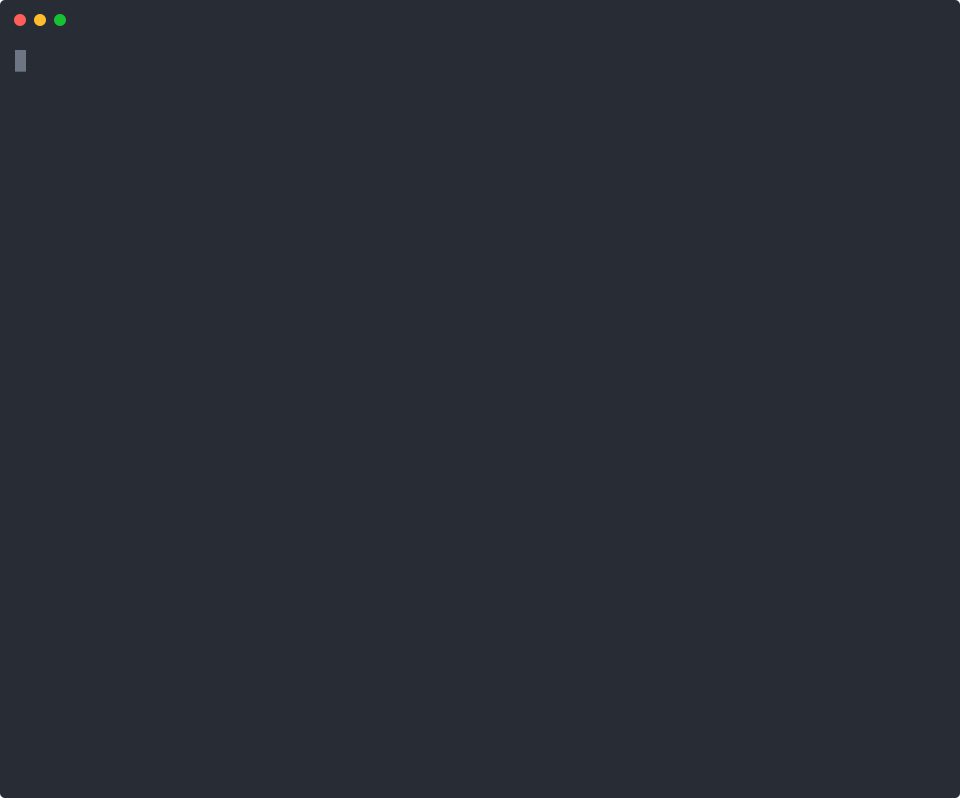
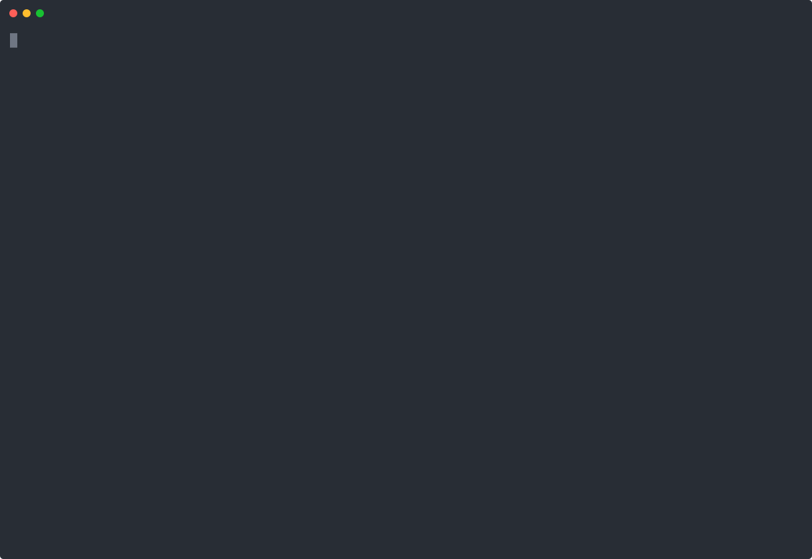

# Succession

Your AI gets a name, a job, and a successor.

Succession is a Claude Code plugin for agent work that spans sessions in a
git project. A named officeholder takes the seat, checkpoints its work and
closes with a handoff. Its successor's script checks the evidence that
handoff points at and shows you a counted verdict before the seat is taken.



Half a minute, replayed from six real sessions. The replies are the
sessions' own words, cut where marked; the time the model took is left
out. [`tests/recording/`](tests/recording/) has the same as a cast, as
plain text, and the script that replays it.

What the script checks is pointers. A claim in a handoff names a commit, a
file in a commit or a log entry, and "pointer verified" means that thing
exists. It does not mean the sentence beside the pointer is true: no
script can tell whether "fixes the login bug" is so. The verdict tells
you which claims rest on something real, and where to look yourself.

## Install

In a Claude Code session, version 2.1.275 or later:

```
/plugin install succession --marketplace thecontinuitylayer/succession
```

This line is taken from Claude Code's documentation and has not been run
by us yet; the two lines below have. Claude Code shows the source and
asks you to confirm it, then opens the plugin's details, where you choose
who gets it and install.

With an older Claude Code, or from a script, use your shell:

```
claude plugin marketplace add thecontinuitylayer/succession
claude plugin install succession@succession-marketplace
```

To try a copy on disk for one session, without installing anything:

```
claude --plugin-dir /path/to/succession
```

Succession needs `git` and a POSIX shell. On Windows that means Git for
Windows, whose Git Bash is what Claude Code uses to run plugin scripts.
The VS Code panel has its own plugin screen (`/plugins`); a plugin
installed with the two shell commands is available there too. To remove
it: `claude plugin uninstall succession@succession-marketplace`, and
delete the `.succession/` folder of a project to remove its record.

**If the install fails on Windows** with `EBUSY: resource busy or
locked, rename '...\marketplaces\<name>..clone' -> ...`, followed by
`EPERM`: this was seen once, on the owner's machine, with VS Code open
on a folder that contained his `.claude` folder (he had `C:\Users`
open). VS Code's git watcher takes hold of a repository cloned inside
the folder it has open about two seconds after the clone, and Claude
Code's rename of the fresh clone then fails. Outside the open folder the
same command worked. What to do:

- Close VS Code, or open a project folder in it and not your home
  folder, then run `claude plugin marketplace add` again.
- After removing the plugin or its marketplace, restart Claude Code
  before you add it again. Removing and adding in the same Claude Code
  session failed the same way.
- If a folder whose name ends in `..clone` is left in
  `.claude\plugins\marketplaces` under your home folder, delete it.

## Start

Open a git project in Claude Code and type:

```
/succession:seat
```

The newcomer shows you a one-page charter, proposes a name such as
`Sextant-001` and tells you what to send to confirm it. That is the whole
setup. Everything it keeps is plain Markdown and JSON in a `.succession/`
folder in your project. There is no account, no server, no database and
no network call.

## What you get

| You type | What happens |
| --- | --- |
| `/succession:seat` | A script checks the pointers in the previous handoff and prints a counted verdict. Then the newcomer proposes a name, you confirm, and it takes the seat as, say, `Astrolabe-002`. |
| `/succession:checkpoint` | A dated note of what was done and where the proof is in git. |
| `/succession:close` | The officeholder writes a handoff and a short note of lessons, and the seat goes vacant. |
| `/succession:lineage` | Every officeholder so far: name, number, dates, what it did, its last words. |
| `Stand down, Astrolabe` | Sent as a whole message, this records a stand-down and tells the officeholder to stop. The record is in the log before the model sees anything. The officeholder is told to start nothing more; you send `/succession:close` when you want the handoff written. |

An officeholder also comes back by name. When a session ends without a
close, or its context is compacted, the seat is still held. The next
session start tells the model that it is, say, `Sextant-001`, shows it
what its last checkpoint recorded and has it read its charter and its
checkpoint note, and its next reply opens with a line such as "I'm
Sextant-001. My last checkpoint says a.txt and b.txt are committed."
Claude Code is given the name as the session's title. Before a
compaction the plugin adds a line to the log, so the record shows when
memory was cut. [Coming back by name](#coming-back-by-name) has the
details and the limits.

It is for people who run long or repeated agent work in a git repository
and are tired of starting over, or of trusting a summary they cannot check.

## What it does not do

Read this before you rely on it.

- **It does not check that a claim is true.** It checks that the commit,
  file or log entry a claim points at exists. Many claims point at
  nothing a script can check, and are listed as "not checkable".
- **It does not run your tests** or any command named in a handoff.
- **The stop phrase is an instruction, not a switch.** A hook records the
  stand-down and tells the model to stop. It cannot force a model to
  stop, and it does not interrupt a turn that is already running.
- **The log shows tampering; it does not prevent it.** Someone who
  rewrites the whole chain, or cuts entries off the end, leaves a log
  that checks out.
- **It works in a git repository and nowhere else**, with one seat per
  repository. Two branches that both write to the record conflict.
- **Its files say a lot about how you work.** Read
  [In a client's repository, or on a team](#in-a-clients-repository-or-on-a-team)
  before you commit `.succession/` to a repository that is not yours alone.
- **Coming back by name is an instruction too.** The session start
  hands the model its name and its last checkpoint. A model can ignore
  that, and what it then says about the work is still the model
  speaking: the checkpoint note and the log are the record.
- **It has been run for real on Linux (headless) and twice on Windows.**
  [Not tested yet](#not-tested-yet) has the list.

## A five-minute tour

1. Open a git project in Claude Code and type `/succession:seat`. With no
   history yet there is nothing to verify. The officeholder shows you a
   one-page charter (what it may do alone, what needs your word), proposes
   a name such as "I'll serve as Sextant-001", and takes the seat when you
   confirm by sending `/succession:seat Sextant`.
2. Work as usual. Type `/succession:checkpoint` whenever something is worth
   recording.
3. At the end of the day, or of the context window, type
   `/succession:close`. It writes the handoff and its lessons, and the
   seat is vacant. The close is written to end the same way every time,
   with four lines and no question from the officeholder:

   ```
   Tenure closed: Sextant-001. The seat is vacant.
   Handoff: .succession/tenures/001-sextant/handoff.md
   Draft check: 5 claims, 4 pointers verified, 0 failed, 1 not checkable.
   Git: the state files in .succession/ are not committed yet. To commit them: git add .succession; git commit -m "Succession: Sextant-001 closed" -- .succession
   ```

4. Next session, type `/succession:seat` again. Before anything else, the
   newcomer runs `scripts/verify.sh` and shows you its output, which ends
   with a line like this:

   ```
   9 claims, 4 pointers verified, 2 failed, 3 not checkable.
   ```

   A failed claim does not stop you from seating the newcomer. It is shown
   to you, written to `verification.md` beside the handoff, and recorded in
   the log. The script also says whether the handoff is still the file
   the predecessor closed with.
5. `/succession:lineage` shows both officeholders.
6. To stop an officeholder at any point, send `Stand down, Sextant` as a
   whole message. The stand-down is recorded, the officeholder is told to
   stop, and it tells you so. Send
   `/succession:close` after that to have the handoff written and the
   seat vacated.

Here is a recorded run of three tenures on a throwaway project, in which
the second officeholder's handoff holds two false claims and the third
officeholder's script catches both:



The same run is in [`tests/recording/`](tests/recording/) as an asciinema
cast (`asciinema play tests/recording/three-tenures.cast`) and as a plain
text transcript.

## Should `.succession/` be in git?

In a repository that is yours alone: yes, if you want the record to
travel and the log to have an anchor. In a client's repository or a
shared one: not by default; see the next section. Either way works, and
each has a cost.

**If you commit it.** The close ends with the command line for it:

```
git add .succession; git commit -m "Succession: Sextant-001 closed" -- .succession
```

Run it in the top folder of the project. It commits what is under
`.succession/` and nothing else, whatever else you have staged. The
officeholder does not run it for you and does not ask: a commit is never
approved in advance, and after a close the tenure is over. The two halves
are joined with `;` and not with `&&`, because Windows PowerShell 5.1
does not know `&&`. In `cmd.exe`, run them as two commands.

What you get: the record travels with the repository; your git history
holds earlier copies of the log, which is the anchor a hash chain needs
(see [The log is tamper-evident](#the-log-is-tamper-evident)); and
`git clean` cannot take it away.

What it costs: **tracked files can be put back by git.** The record
changes again at the next seating, checkpoint or stand-down, so the
folder is seldom clean for long. While it has changes that are not
committed, `git stash`, `git checkout -- .` and `git reset --hard` put
`seat.json`, `log.jsonl` and `lineage.jsonl` back to the last commit
without a word. A seating or a stand-down recorded since then is gone
from the state files. So:

- The same command line works at any time, not just after a close. Run
  it before you stash, reset or switch branches, or whenever
  `git status` shows `.succession/` as changed. Give it another message
  if you like.
- If you forgot, look in `git stash list` and `git reflog` for the newer
  files.
- The plugin notices what it can, and says so in a line that starts
  with `WARNING:`, printed by the session-start hook and by the next
  seating. Three things set it off: a tenure folder that `seat.json`
  does not know about; the note a stand-down leaves in the tenure folder
  (`stood-down`) beside a seat that reads occupied; and a `seat.json`
  that does not say what the log's last seat entry says, which is what
  is left when one of the two files is put back without the other. Git
  leaves files it does not track alone, which is why the folder and
  the note survive. A checkpoint that was taken back shows as a failed `log:`
  pointer. The warning never blocks anything: you decide which file is
  right. A change with no such trace is not noticed.
- Tracked files also follow the branch you have checked out: on a branch
  that lacks the latest commit of `.succession/` you see the older seat
  and log.

**If you keep it out of git.** Add `.succession/` to your `.gitignore`
(or to `.git/info/exclude`, which is yours alone and is not shared).
Git then never touches the folder: no stash, checkout or reset can put
it back. The close ends with "`.succession/` is ignored by git in this
project, so there is nothing to commit". The cost is the other way
round: the record lives in that one working folder, a `git clean -x`
or a lost disk takes it, and the log has no anchor.

What does not depend on the choice: the verdict. `verify.sh` reads
`.succession/` from your working folder, and reads git for the commits
and files that the claims point at.

## In a client's repository, or on a team

**Default to keeping `.succession/` out of git** (the `.git/info/exclude`
line above does it without touching the client's `.gitignore`), unless
the client wants the record. Once committed and pushed, it is part of
their history.

What the files reveal to anyone who can read the repository:

- The time, to the second, of every seating, checkpoint, stand-down,
  close and compaction: when you worked, and for how long.
- That named AI agents did the work, and how many.
- The charter: what the agent was allowed to do without asking.
- Notes written by a model: handoffs, lessons and checkpoint notes, with
  whatever the model knew about the work. Its one-line summaries and
  "last words" are copied into `log.jsonl` and `lineage.jsonl` too.

**Read all of it before you share it**, the log and the lineage as well
as the Markdown files. The skills tell the model to keep secrets and
personal details out; a model can still put one in.

**If a secret lands there.** In a handoff, lessons or checkpoint file,
edit it out; if the tenure has closed, `verify.sh` will say the handoff
changed after the close, which is true. In `log.jsonl` there is no
quiet fix, on purpose: edit the line and the chain reports that entry
as edited from then on. Either accept that (the report is honest: the
entry was edited), or start a new record as described below. If the
secret was pushed, treat it as leaked: rotate it. Rewriting git history
is your tool, not this plugin's.

**More than one person, or more than one branch.** There is one seat per
repository. Two branches that each seat, checkpoint or close will
conflict in `log.jsonl`, `lineage.jsonl` and `seat.json` when merged,
and a merged log is a broken chain. Keep the record on one branch, or
out of git. A linked worktree (`git worktree add`) has its own working
folder and so its own `.succession/`: its state is separate from the
main folder's.

**If the chain is broken.** `verify.sh` names the entry and exits
non-zero every time until the file is whole again. There is no repair
command, because a repair command would be a way to forge. What you can
do honestly:

- If `.succession/` is in git, find the last commit where the log checks
  out (`git log -- .succession/log.jsonl`) and compare. If the damage
  was an accident, put that copy back with
  `git checkout <commit> -- .succession` and accept that later entries
  are lost.
- Or close the book: rename the folder (for example to
  `.succession-until-2026-10`), keep it as it is, and start again with
  `/succession:seat`. Numbering starts over at 001, and the old folder,
  broken chain and all, stays as the record of what came before. Say so
  under "Owner's notes" in the new charter.

## What the verifier checks, and what it cannot

A handoff makes claims. Each claim is one line with an evidence pointer:

```
- CLAIM [commit:3f2a9c1] Added the login form
- CLAIM [file:src/login.js@3f2a9c1] The form lives here
- CLAIM [log:9b1c44e07a2d] Checkpoint after the migration
- CLAIM [none] Deployed to staging on Tuesday; the owner can confirm in the dashboard
```

| Pointer | What `verify.sh` checks |
| --- | --- |
| `commit:<sha>` | The commit exists and is an ancestor of `HEAD`. |
| `file:<path>@<commit-sha>` | The file exists in that commit (`git cat-file`). |
| `log:<entry-hash>` | The entry exists in `.succession/log.jsonl`. |
| anything else | Recorded as "not checkable". |

Each claim gets one of four statuses: **pointer verified**; **pointer
verified, changed since** (the file was in the claimed commit and differs
at `HEAD`, which is not a failure); **FAILED**; **not checkable**.

A commit id is matched against commits alone. A branch or a tag is not
accepted, even one whose name is made of hex digits.

Be clear about how far this goes:

- **Many real claims are not checkable by a script.** Whether the code is
  correct, whether a deploy happened, what you agreed to: a script cannot
  check any of that. Those lines are counted and listed as "not
  checkable" so that you can decide what to look at. They are not judged
  true or false.
- **A verified pointer proves existence, not truth.** `commit:3f2a9c1`
  verified means that commit is in your history. It does not mean the
  commit does what the sentence beside it says, or was made when the
  sentence says. In one of our own test runs a model wrote "made before
  this tenure" beside a commit made during it; the pointer was verified,
  and the sentence was false. The output and `verification.md` say on
  every run that sentences are not checked.
- **The verifier does not run tests** or any other command. See the
  comparison below for tools that do.
- **Uncommitted work has nothing to point to.** Pointers name commits. The
  working tree is never hashed, which is also why line-ending settings
  (`core.autocrlf`) cannot change a verdict.

The verdict comes from the script and from nothing else. The skills tell
the model to show the script's output unedited and never to restate it.

The verifier treats handoff text as data. It never runs a command, a path
or a script named in a handoff or a checkpoint, and it opens no file
outside your project. A pointer such as `cmd:rm -rf x`, or a path that
contains `../`, is reported as "not checkable" and nothing else happens.

The handoff itself is bound to the log. The close records the sha256 of
the handoff in its log entry, and `verify.sh` compares: a line added to
the handoff after the close is reported as `Handoff: CHANGED since the
close`. A close written by an earlier build carries no sha256; that is
reported as not recorded, and is not a failure.

`verify.sh` exits non-zero when a claim failed, the log chain is broken or
the handoff was changed after the close.

## The log is tamper-evident

Entries in `.succession/log.jsonl` are added at the end and never
rewritten. Each entry holds the sha256 of the entry before it, and its own
hash. `verify.sh` walks the chain every time
it runs. If someone edits a line by hand, the script names the broken
entry and exits non-zero.

What this does and does not give you:

- An edit to any recorded entry is detected.
- It is evidence of tampering, not prevention. Someone who rewrites an
  entry and then recomputes every hash after it produces a chain that
  checks out. Entries removed from the end of the file leave a shorter
  chain that also checks out.
- Committing `.succession/` to git is what anchors it: your git history
  then holds earlier copies to compare against.
- The log records what the scripts were asked to record. It cannot prove
  who or what ran them.
- The seat cannot be claimed until the latest handoff has a verdict in
  the log. Which tenure ended last is read from the log, not from
  `lineage.jsonl`, which is a plain list for people to read.

What to do about a broken chain is under
[In a client's repository, or on a team](#in-a-clients-repository-or-on-a-team).

## The stop phrase

`Stand down, <codename>` fires when it is your whole message, with nothing
before or after it except spaces or line breaks. Letter case does not
matter. One full stop or one exclamation mark straight after the codename
is accepted, because dictation adds them: `Stand down, Astrolabe.` works.
Any other punctuation there, or a second mark, and it does nothing.

It does nothing when the phrase appears inside a longer message, inside a
paste, or inside quotation marks. "Please stand down the server" does
nothing.

On a match, a hook appends a `stand_down` entry to the log and marks
`seat.json` as `stood_down`. Then it tells the model to stop, to start
nothing and call no skill by itself, and to tell you in a sentence or two
that the stand-down is recorded and that sending `/succession:close`
writes the handoff and vacates the seat. The record is on disk before the
model reads the message, so it exists even if the model were to ignore
the instruction, and every later session start repeats it until the
tenure is closed.

The stop phrase records and tells. The close is your next move: send
`/succession:close` when you want the handoff and the lessons written
from what is already done. Typed by you, its steps are approved in
advance (see [Permission prompts](#permission-prompts)). Until then the
seat reads `stood_down` and the officeholder does no further work.

The hook can ask the model to stop. It cannot force a model to stop, and
it does not interrupt a turn that is already running. To halt work in
progress, use Claude Code's own interrupt, then send the phrase.

If the stand-down cannot be written (another write holds the lock, or the
folder cannot be written to), the hook gives up after three seconds by
the clock, well inside its ten, and has the officeholder stop and tell
you that it could not be recorded. It also hands Claude Code a warning to show you
directly (a `systemMessage`), in case the model does not pass it on. A
lock left by a process that was killed is cleared after two seconds, so
the stand-down behind it is still recorded.

## Coming back by name

A tenure usually outlives a session. The terminal is closed, the
machine sleeps, or the context fills up and Claude Code compacts it.
None of that vacates the seat: it is held until a close.

**At a session start with the seat held**, the session-start hook adds
three things to what it has always printed:

- the tenure's last checkpoint as the log has it: the entry's number,
  its time and its one-line summary, cut at 200 characters, or the fact
  that none is recorded yet;
- two or three sentences to the model: that it is `Sextant-001`, the
  officeholder seated here; to read the charter and the latest
  checkpoint note before it continues; and to open its next reply with
  one short line that gives its name and what that checkpoint recorded;
- the session's title, `Sextant-001`, through a second hook that prints
  one small JSON document. Claude Code takes a title from a hook at a
  new session, a resumed one and a fork, and the plugin leaves a session
  alone that already has a title of its own (one you gave with `--name`
  or `/rename`, or an earlier one from the plugin).

**After a compaction** the same text says that the context was just
compacted and that the checkpoint note and `.succession/log.jsonl` are
the record to trust over memory.

**Before a compaction**, manual (`/compact`) or automatic, a third hook
adds one entry to the log, and to nothing else: `Context compacted
(manual).` or `Context compacted (auto).`, with a sentence saying that
the plugin wrote it. It has the type `checkpoint`, so that the log reads
the same to an older copy of the verifier, and the session start does
not count it as the officeholder's checkpoint. The hook cannot hold a
compaction up: it prints nothing, always exits 0, and gives up after
three seconds if another write holds the lock, with one line on
standard error.

None of this is added when the seat is vacant, when the officeholder
was stood down, or when the session start has a `WARNING:` to give.
Then the text is what it was before.

The limits:

- The checkpoint summary is text a model wrote, passed on from the log
  without the chain being checked at that moment (`verify.sh` checks
  it). It is one line of at most 200 characters, and an entry that could
  not have come from the plugin's script (too long, or holding a control
  character) is not shown.
- What the officeholder knows after a session ended is what it wrote
  down. Work since the last checkpoint is in git and in the files, not
  in the record. Take a checkpoint before you stop for the day.
- A session resumed with a title from an earlier officeholder keeps that
  title.
- In sessions run for this version, the model twice went on to check its
  checkpoint's claims with `git ls-tree`, unprompted, after reading the
  note. Claude Code asks about that command under default permissions.

## Files it keeps

```
.succession/
  charter.md        one page: what the officeholder may do alone
  seat.json         who holds the seat now
  lineage.jsonl     one line when an officeholder is seated, one when it leaves
  log.jsonl         the hash-chained log
  tenures/
    001-sextant/
      checkpoints.md
      handoff.md
      lessons.md
      verification.md   the script's verdict on this tenure's handoff
      stood-down        a note left by a stand-down, if there was one
    002-astrolabe/
      ...
```

For a moment during a write there are also `seat.json.tmp`,
`charter.md.tmp`, `verification.md.tmp` and the folders `.lock` and
`.lock-clear`. A symbolic link at any of these paths, or at any file or
folder above, is never followed: it is refused, or removed if it is in
the way of a short-lived file.

Numbers are zero-padded and never reused. The default name theme is
navigation instruments; put your own names in `.succession/names.md` to
change it.

Whether these files belong in your git history is answered under
[Should `.succession/` be in git?](#should-succession-be-in-git).

## What runs on your machine

Five POSIX shell scripts, and nothing else. No `jq`, `node` or `python`.

| Script | When | What it does |
| --- | --- | --- |
| `scripts/session-start.sh` | Session start, resume, clear, compact, fork (a hook) | Prints up to 2,000 characters: seat status, charter path, latest handoff path and the verdict in the log's last verify entry for it, and a warning when the state files look older than the tenure folders. With the seat held and no warning: the last checkpoint in the log and who the session is (see [Coming back by name](#coming-back-by-name)). Prints nothing in a project without `.succession/`. Writes nothing. |
| `scripts/session-start.sh title` | New session, resume, fork (a second hook) | With the seat held and no warning, prints one JSON document that gives Claude Code the officeholder's name as the session's title. Otherwise prints nothing. Its input is read for one thing: whether the session already has a title. |
| `scripts/compact-mark.sh` | Before a compaction (a hook) | With the seat held, has `log-append.sh` add one entry to the log. Prints nothing, always exits 0. |
| `scripts/stand-down.sh` | Every submitted prompt (a hook) | Compares the prompt with the stop phrase. On a match, calls `log-append.sh`. The prompt is examined in memory and is never stored. |
| `scripts/verify.sh` | When the seat, checkpoint or close skill calls it | Checks pointers and the log chain with `git cat-file`, `git rev-parse` and `git merge-base`, and the handoff against the sha256 in its close entry; writes `verification.md`. |
| `scripts/log-append.sh` | When a skill, the hook or `verify.sh` calls it | The single writer of `log.jsonl`, `seat.json` and `lineage.jsonl`. Writes the charter from the template when the project has none. At a close it also asks `git status` and `git check-ignore` about `.succession/`, to print the last line of the close. It stages and commits nothing. |

The session-start and prompt hooks are kept cheap, because one of them
runs on every prompt and starting a process is slow on Windows. In a
project without `.succession/`, neither starts another process: they
look for the folder with shell builtins. (The hook before a compaction
runs seldom and asks `git` each time.) The prompt hook also starts none while nobody
holds the seat, and one `awk` process while somebody does. (Where the
repository root cannot be found by looking at folders, for instance when
`GIT_DIR` is set, the hooks ask `git`, as they always do before anything
is written.) `sh tests/bench.sh` measures the hooks on your machine, and
the workflow runs it on every push. Over its runs on GitHub's hosted
machines in October 2026 with the hooks as they are now, the prompt
hook's median time in a project without `.succession/` was 2 ms on
Linux, 5 ms on macOS and 27 to 55 ms on Windows. With a seat held it was
4 to 5 ms, 8 ms and 46 to 67 ms. The Windows figures move with the
machine: starting an empty `sh` script there took 25 to 39 ms in the
same runs.

The skills run `verify.sh` and `log-append.sh` through Claude Code's Bash
tool. The next section says which of those calls are approved in advance.
The hooks never ask.

The plugin makes no network calls, fetches nothing, never reads the
conversation transcript or chat history, and writes nothing outside
`.succession/`. See [PRIVACY.md](PRIVACY.md).

## Permission prompts

Under Claude Code's default permission mode you are asked before a shell
command runs and before a file is changed. Three of the four skills carry
a short list of actions that are approved in advance (`allowed-tools` in
the skill's front matter), so that a skill you typed can run through
without a question. It does when the model keeps to the skill's steps;
[Where you are still asked](#permission-prompts) lists what was seen
when it did not.

| Skill | Approved in advance |
| --- | --- |
| `seat` | `verify.sh` with no arguments. `log-append.sh charter`, which writes the template charter when there is none and never changes one that is there. `log-append.sh seat <Codename>`. |
| `checkpoint` | `log-append.sh checkpoint <summary>`. `verify.sh --draft --checkpoints`. Writing `checkpoints.md` in a tenure folder under `.succession/tenures/`. |
| `close` | `verify.sh --draft`. `log-append.sh close <summary> <last words>`. Writing `handoff.md` and `lessons.md` in a tenure folder under `.succession/tenures/`. |
| `lineage` | Nothing. It reads files in your project, which Claude Code allows anyway. |

That is the whole list: ten entries. Each script is named by its full path
inside the plugin folder, and each file by its name and its place under
`.succession/`. `sh tests/lint.sh` fails when a skill lists anything else.

The seat skill reads the predecessor's handoff and lessons, which are
text from the repository and not you speaking. That is why no edit to
the charter is approved in advance: the script can create it, and a
change to an existing charter always asks you. The skill tells the model
to change the charter on your word in the conversation and for no other
reason, and to tell you when a file asks for such a change.

**How long it lasts.** The approval holds for the turn in which you use
the skill. It ends when you send your next message. That is Claude Code's
rule for skills, and the plugin cannot extend it.

**What is never approved in advance.**

- `git add`, `git commit`, `git push` and every other command that is not
  one of the script calls above.
- Any file outside `.succession/`.
- Any other file inside it. The scripts write `seat.json`, `log.jsonl` and
  `lineage.jsonl`; a model that tries to change them by hand gets the
  usual question.
- Recording a seat as vacated (`log-append.sh vacate`). It ends a tenure
  with no handoff, so it is left to ask on purpose.
- A script call with a command substitution in it, or one whose output is
  sent to a file that is not in the table.
- Anything that uses the network.

Claude Code's documentation adds that deny and ask rules in your own
settings win over a skill's list.

**Where you are still asked.** Seen in real sessions:

- You confirm a name with a plain "yes". That is a new message, so
  Claude Code asks you to approve the one command that claims the seat.
  Send `/succession:seat <Codename>` instead: that command is approved
  in advance.
- The model starts a skill itself, as it does when you ask in plain
  words ("please record a checkpoint") instead of typing the skill.
  Claude Code asks whether that skill may run, because the skill carries
  approvals. In runs with Claude Code 2.1.294 where the owner's settings
  already allowed the skill, the approvals then did not apply, and the
  scripts and the files were asked about as before. Typing the skill
  avoids all of it. The stop phrase does not lead here: the officeholder
  starts no skill after it, and you type `/succession:close`.
- Claude Code was started in a sub-folder of the repository. Then
  `.succession/` is outside its working folder and it asks before reading
  there. Start it in the top folder.
- The officeholder runs a git command other than `git log` and
  `git status`. In one run of the tour the model ran `git ls-tree` on a
  commit during a checkpoint, unprompted, and was asked about it. The
  skills now name the two commands to use; a model can still pick
  another.
- The officeholder stages or commits files, or writes a file that is not
  in the table. The skills tell it to leave the commit of `.succession/`
  to you.

Not run, but they follow from the list and from the rule about turns:

- You ask for a change to the charter, at any time. The edit asks.
- You ask for another try at a handoff or a checkpoint note, in a later
  message without typing the skill again. The edit asks.
- The officeholder records a seat as vacated.

These results come from headless sessions on Linux
(`sh tests/live/permissions.sh`), where an action that would raise a
question is refused and listed. See [Not tested yet](#not-tested-yet) for
what that leaves open.

## How it compares with existing handoff tools

Handoff tools for Claude Code already exist and several of them check
their work. This is what each one does today, as described in its own
README (read in October 2026).

| Tool | What it already does |
| --- | --- |
| [ostikwhy-blip/claude-code-handoff-skill](https://github.com/ostikwhy-blip/claude-code-handoff-skill) | Writes `HANDOFF.md` from live `git` output and tags each claim as verified or recalled. **On resume it re-verifies the verified claims against the current repository, reports drift, and waits for your go-ahead.** The model does the checking; there is no script, count, log or named officeholder. |
| [geekidharsh/handover](https://github.com/geekidharsh/handover) | An enforced handover document. **Each state claim carries its own verify command or an explicit "unverified" tag, and a linter with no model in the loop runs the commands and scores the document.** It goes further than Succession on what a claim can prove, because it can run a test. The trade-off is that it executes commands taken from the document when you ask it to. |
| [AnExiledDev/compact-handoff-plugin](https://github.com/AnExiledDev/compact-handoff-plugin) | Writes the compaction handoff itself, with a tool ledger and live repository state. **Handoffs are numbered and written once, each one names its predecessor, and its logs are never rewritten.** It captures context automatically, which Succession does not do. |
| [willseltzer/claude-handoff](https://github.com/willseltzer/claude-handoff) | `/handoff:create`, `/handoff:quick` and `/handoff:resume`, readable by any coding agent. **On resume it checks whether the repository has drifted** since the handoff was written. Failed approaches are a required section. |
| [mattpocock/skills](https://github.com/mattpocock/skills) (`handoff`) | A plain handoff: compacts the conversation into a document another agent can continue from. No checking step on resume. |
| [ek33450505/attest](https://github.com/ek33450505/attest) | Not a handoff tool, but close in spirit: a hook with no model in the loop that checks a subagent's "done" claim against the real git working-tree change. |

What Succession adds to that picture:

- A verdict on a handoff's pointers that is **counted, recorded in a log,
  and gating the seat**: the seat script refuses to seat anyone until
  that verdict is in the log. (A checker with no model in the loop is
  not new: handover has one, and it can prove more per claim.)
- A **hash-chained, tamper-evident log** of seatings, checkpoints,
  verdicts, closes and stand-downs.
- **Named officeholders with a numbered lineage.**
- An **owner stop phrase** that is recorded whether or not the model obeys.
- A verifier that **never executes handoff content**.

What it does not do that others do: run tests or per-claim commands, write
a handoff automatically at compaction (it notes the compaction in the
log and nothing more), or work outside a git repository.

## Requirements and limits

- A git repository is required. Outside one, the seat skill says so and
  stops.
- `sha256sum`, or `shasum -a 256` where that is missing (macOS).
- One seat per repository in this version.
- The scripts are tested on Linux, macOS and Windows: a GitHub Actions
  workflow (`.github/workflows/test.yml`) runs the test suite on every
  push, on three hosted machines. That is the scripts run by a shell.
  Claude Code itself has run the plugin on Linux (headless sessions) and
  twice on Windows, and never on macOS; see
  [Not tested yet](#not-tested-yet).

  | Machine | Shell that runs the scripts | awk |
  | --- | --- | --- |
  | Ubuntu, x86_64 | `sh` is dash | GNU awk 5.2 |
  | macOS, arm64 | `sh` is bash 3.2 | the system awk, version 20200816 |
  | Windows, x86_64 | Git Bash from Git for Windows 2.55 (`sh` is bash 5.3), with `core.autocrlf=true` as the installer sets it | GNU awk 5.4 |

  On each of the three the suite passes, and passes again from a clone of
  the plugin made with `core.autocrlf=true`, with the same verdict lines.
  State files with CRLF line endings are part of the suite on all three.
  Under Git Bash, `grep`, `sed` and `awk` drop the carriage return of a
  CRLF line before they look at it; the scripts strip it in the shell
  and do not depend on those tools to see it.
  On Linux the suite was also run under `mksh` and busybox `sh`, and with
  four `awk` implementations.
- In a shallow clone, commit ancestry cannot be decided; such claims are
  reported as "not checkable".
- `verify.sh` runs one hash per log entry. A log with thousands of entries
  will take a while under Git Bash.
- One write at a time. `log-append.sh` takes a lock (the folder
  `.succession/.lock`), and a write that finds it taken waits: for as
  long as the lock keeps changing hands, up to 90 seconds, and for 20
  seconds behind one process that keeps it. Then it writes nothing, says
  so and exits 4; no entry is dropped without a message. The stop
  phrase waits three seconds, as said above.
- A lock is cleared when the process named in it has been gone for two
  seconds. "Gone" is the shell's answer (`kill -0`), and the shell cannot
  see a writer that belongs to another user or that runs under another
  Unix layer on the same folder (WSL next to Git Bash, a container next
  to its host): such a writer can lose the lock if it holds it for more
  than two seconds, and it then stops before the log if the lock is no
  longer its own when it looks, which is just before it writes.
- The hook cannot tell a prompt you typed from one that Claude Code
  submits on your behalf, because the hook input has no field for that:
  the stop phrase also fires when it arrives as a scheduled task's prompt,
  a background subagent's report or a message from another session.

## Not tested yet

What has been run for real, by Claude Code itself:

- Headless sessions on Linux, with Claude Code 2.1.294. Every result in
  [Permission prompts](#permission-prompts) comes from these. So do runs
  of the tour above in six sessions, typed as an owner would type it. In
  most of them nothing was refused; in one, a git command the model
  chose by itself during a checkpoint was (see "Where you are still
  asked").
- Headless sessions on Linux with Claude Code 2.1.295, for
  [Coming back by name](#coming-back-by-name): a seat, a checkpoint and
  no close in one conversation; a new conversation, whose reply to
  "Where were we?" began "I'm Sextant-001. My last checkpoint says a.txt
  and b.txt are committed."; then `/compact` in that conversation, which
  left its entry in the log, and a reply to "Carry on." that began with
  the name and the checkpoint again. Claude Code reported the session
  title as `Sextant-001` and wrote it into the session's transcript. The
  tour was run again with this version.
- One interactive session on Windows, in the Claude Code panel of VS
  Code, run by the plugin's owner: Claude Code 2.1.294, Git for Windows
  2.55.0, and an earlier build of the plugin (0.1.3), installed with the
  two shell commands above. The seat, the confirmation with
  `/succession:seat <Codename>`, a checkpoint, the stop phrase and the
  close worked from start to finish, and the hook had the stand-down in
  the log before the close.
- A session in a plain terminal on Windows, run by the plugin's owner:
  Claude Code 2.1.294, in its auto permission mode, with version 0.9.0
  installed from the public repository with the two shell commands.

What has not:

- A real session on macOS, of any kind. There the scripts were run by the
  workflow, in the shell Claude Code uses for hooks, and not by Claude
  Code itself.
- An interactive session in a terminal, on macOS or on Linux. Every real
  session on Linux was headless, where a question cannot be answered and
  counts as a refusal.
- Coming back by name, anywhere but in headless sessions on Linux with
  Claude Code 2.1.295: not in an interactive session, not on Windows or
  macOS, and not with the plugin installed from a marketplace (the
  sessions loaded it with `--plugin-dir`). Where the session title shows
  in Claude Code's own screens was not looked at; headless, Claude Code
  reported it and stored it.
- An automatic compaction. The manual one (`/compact`) was run for real;
  for the automatic one the hook was given the word `auto` by the tests,
  as Claude Code's matcher would give it.
- A Claude Code that does not take a session title from a session-start
  hook. The title has a hook of its own so that the status text does
  not depend on it, but no such version was run.
- In an interactive session: seating a successor over a real handoff, and
  the lineage skill. The Windows session did not get that far.
- The four closing lines of a close, in an interactive session. They are
  newer than the Windows session and were seen in headless sessions on
  Linux.
- The approvals in [Permission prompts](#permission-prompts), anywhere
  but in headless sessions on Linux. The Windows sessions were not used
  to check them (the second ran in auto mode, where Claude Code decides
  without asking). What the question looks like, what "don't ask again" then
  saves, and whether the approvals apply after you answer yes to a skill
  the model started, were not seen. An approval for a script matches the
  command text, which holds the path of the plugin folder, and how that
  path is spelled in a Windows session was not checked.
- The one-line install, `/plugin install succession --marketplace ...`.
  It is taken from Claude Code's documentation and was not run. The two
  shell commands were, on Windows, from the public repository.
- The warning Claude Code is given to show you when a stand-down cannot
  be recorded, in an interactive session. In a headless session on Linux
  it arrived as a notice that begins "UserPromptSubmit says:", and the
  officeholder said so too.
- Symbolic links on Windows. The tests that plant links under
  `.succession/` are skipped where the shell cannot make one, which is
  the case under Git Bash by default.
- The command line at the end of a close, in PowerShell and in `cmd.exe`.
  The tests run it in `sh` on all three systems, which on Windows is Git
  Bash.
- Claude Code versions other than 2.1.294 and 2.1.295, and organizations whose
  managed settings switch off approvals carried by skills.

## Tests

```
sh tests/run.sh        # three tenures, the stop phrase, hostile claims, session start, compaction, the log, the close, safety
sh tests/autocrlf.sh   # the whole suite again in a core.autocrlf=true clone
sh tests/lint.sh       # shellcheck, POSIX syntax, the approvals list, copies of shared text, one version
sh tests/bench.sh      # wall time of the two hooks
sh tests/platform.sh   # how this machine's shell and text tools treat CRLF
```

Two more checks are run by hand and are not part of the workflow, because
they start real Claude Code sessions and so need a signed-in `claude` and
cost usage (fourteen sessions, and six for the tour):

```
sh tests/live/permissions.sh                             # what Claude Code asks about under default permissions
SUCCESSION_LIVE_ONLY=tour sh tests/live/permissions.sh   # the tour above, typed as an owner would, in six sessions
```

The tests need `git` and a POSIX shell, and nothing else. To record the
three-tenure run again, slowly enough to read:

```
SUCCESSION_DEMO=1 SUCCESSION_DEMO_PAUSE=3 asciinema rec --command "sh tests/three-tenures.sh" demo.cast
```

The recording at the top of this page is of another kind: it runs
nothing. `tests/recording/come-back.sh` prints what was typed and
answered in six real sessions, and says so in its opening lines.

## Version and license

Version 0.9.1. It becomes 1.0.0 once a real session on macOS, an
interactive session in a terminal and the one-line install have been
run. Changes are in [CHANGELOG.md](CHANGELOG.md). To report a security
problem, see [SECURITY.md](SECURITY.md). MIT; see [LICENSE](LICENSE).
